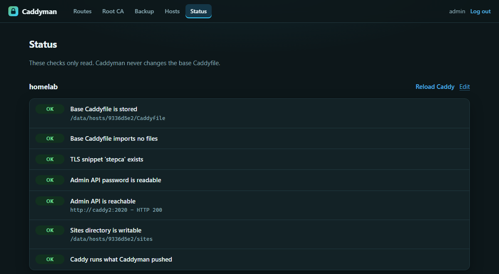

# Caddyman

[](https://github.com/Marschux/Caddyman/tags)
[](LICENSE)
[](https://github.com/Marschux/Caddyman/pkgs/container/caddyman)

A web interface for Caddy routes that works with your own ACME CA.


Caddyman is a form in front of a directory: one file per route, written where Caddy reads it,
followed by a reload. It is built for setups where certificates come from an internal CA such as
[step-ca](https://smallstep.com/docs/step-ca/), and it helps with the part that usually goes
wrong there: getting the root certificate onto the clients.

## What it does

- Reverse proxy, redirect and static file routes, with optional basic auth per route
- Four TLS modes per route: your own ACME CA, Caddy's default, Caddy's internal CA, or none
- Shows the issuer and remaining lifetime of the certificate each route really serves, and
  flags a route that quietly got its certificate from Caddy's internal CA instead of yours
- Root CA page: download, fingerprints, and import instructions for Windows, Debian and Firefox
- Edits routes it did not create as plain text, and can adopt them if they match a known pattern
- Backup and restore of all routes as a ZIP
- Caddy on the same machine or on another one

## How it works

Three rules shape everything else:

1. **The route files are the database.** There is no second copy of the configuration that could
   drift from what Caddy reads after a restart.
2. **Caddyman never generates JSON.** It sends the Caddyfile as text and lets Caddy adapt it, so
   a route behaves exactly as if Caddy had loaded it from the file itself.
3. **Your base Caddyfile is only read.** The status page tells you what is missing and gives you
   the lines to copy; it writes nothing.

If Caddy rejects a change, the file is put back as it was and the error is shown in the form.

## Installation with Docker

Caddyman expects a Caddy that keeps its routes in a directory of their own. The base Caddyfile
needs three things, and the status page checks each of them:

```
{
	admin :2019
}

(stepca) {
	tls {
		ca https://ca.home.example/acme/acme/directory
		ca_root /etc/caddy/root_ca.crt
	}
}

import /etc/caddy/sites/*.caddy
```

- `admin :2019` lets Caddyman reach the admin API from its own container. See
  [Securing the admin API](#securing-the-admin-api) before you add it.
- The snippet is only needed for the "Own ACME CA" mode. Its name is up to you.
- The `import` line is where the routes come from.

Then run [`docker/compose.yml`](docker/compose.yml). It mounts Caddy's Caddyfile and sites
directory at the same paths the Caddy container uses and joins the Docker network `proxy-net`;
adjust both to your setup. Settings are optional and go into a `.env`, see
[`docker/.env.example`](docker/.env.example).

On first start there is no account yet. Open `http://<host>:5052/setup` and enter the token from
the log:

```
docker logs caddyman
```

After that, add your Caddy host. The status page shows what is still missing.

To build the image yourself: `docker build -f docker/Dockerfile -t ghcr.io/marschux/caddyman:latest .`



## Caddy on another machine

Choose "On another machine" when adding the host. Caddyman then keeps the base Caddyfile and the
routes in its own volume and sends both to Caddy as one Caddyfile. Three things are different:

- Start that Caddy with `caddy run --resume --config /etc/caddy/Caddyfile --adapter caddyfile`.
  Without `--resume` a restart goes back to the file and drops every route. The status page
  notices when that has happened.
- Every push replaces Caddy's **whole** configuration. The base Caddyfile you paste into Caddyman
  therefore has to contain everything that is not a route, including the site that exposes the
  admin API. Leave that out and the first push locks Caddyman out.
- The admin API has to be reachable over the network, so it needs protection.

## Securing the admin API

Caddy's admin API has no login of its own. Whoever reaches it controls Caddy.

**Same machine.** With `admin :2019` the port is not published, but every container on the same
Docker network can reach it, which includes every service behind the proxy. If that is too
open for you, give Caddy and Caddyman a network of their own.

**Another machine.** Put the admin API behind a site with basic auth and enter the login at the
host in Caddyman:

```
admin.home.example {
	basic_auth {
		caddyman <hash from: caddy hash-password>
	}
	reverse_proxy localhost:2019 {
		header_up Host {upstream_hostport}
	}
}
```

The `header_up` line is required: the admin API refuses requests whose Host header is not its
own address. At the very least, firewall the port to the machine Caddyman runs on.

## Configuration

| Variable | Default | |
|---|---|---|
| `CADDYMAN_SECRET_KEY` | generated | Signs sessions and encrypts admin API passwords. `openssl rand -base64 32` |
| `CADDYMAN_ADMIN_USER` | | Together with the hash below: skips the setup page |
| `CADDYMAN_ADMIN_PASSWORD_HASH` | | bcrypt. In a `.env` every `$` is written as `$$` |
| `CADDYMAN_FORWARDED_ALLOW_IPS` | `127.0.0.1` | Whose `X-Forwarded-*` headers are trusted. Behind Caddy: its address or the Docker subnet |
| `CADDYMAN_HOST` / `CADDYMAN_PORT` | `0.0.0.0` / `5052` | |
| `CADDYMAN_DATA_DIR` | `/data` | Account, hosts, change log |

## Good to know

- **Set the secret key.** Without one, a key is generated into the data volume, right next to
  what it protects. If the key is lost, sessions end and the admin API passwords have to be
  entered again; nothing else is affected.
- **Keep port 5052 published**, even once Caddyman has a route of its own. It is the way back in
  if that route is ever broken or deleted.
- **Forgot the password?** Delete `auth.json` from the data volume and restart. The setup page
  comes back with a new token in the log.
- **The backup does not contain your root CA.** It lives in the volume of your CA. Back that up
  separately; it matters more than the routes. A lost root has to be imported on every device
  again.
- **A route on a port other than 80 or 443** needs that port published on the Caddy container.
  Caddyman cannot check or change that.
- A deleted route leaves its certificate in Caddy's storage, where it simply expires.

Not included on purpose: user management and roles, load balancing, free-form headers, metrics,
and an undo history. For history, put the sites directory under Git.

## Development

```
pip install -r docker/requirements.txt
CADDYMAN_DATA_DIR=./data python -m app.server
python -m unittest tests.test_main
```

## License

AGPL-3.0-or-later. See `LICENSE`.

## AI use

Most of this project's code was written with AI assistance (Claude Code). Commits and design
decisions were reviewed by the maintainer.

## Links

- [Issues](https://github.com/Marschux/Caddyman/issues)
- [Container registry](https://github.com/Marschux/Caddyman/pkgs/container/caddyman)
