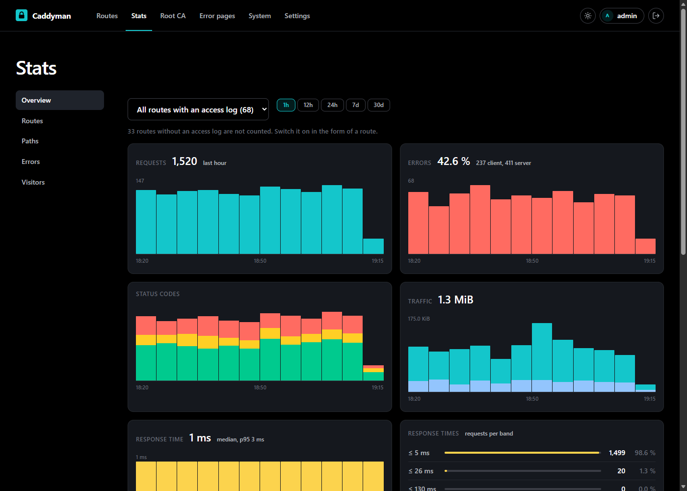

# Caddyman

[](https://github.com/Marschux/Caddyman/tags)
[](LICENSE)
[](https://github.com/Marschux/Caddyman/pkgs/container/caddyman)

A web interface for Caddy routes that works with your own ACME CA, such as
[step-ca](https://smallstep.com/docs/step-ca/).


- **Routes:** reverse proxy, redirect or static files, with several hostnames, wildcards and paths to other targets
- **Route list:** groups that fold away, a search, filters for problems and for what is left to do, and pages of 25 to 200 routes
- **Access per route:** basic auth, allowed networks, or your single sign-on through a `forward_auth` snippet
- **Error pages:** a page in a design you pick per error, where Caddy would send an empty one
- **TLS per route:** your own ACME CA, Caddy's default, Let's Encrypt over DNS, Caddy's internal CA, or none
- **Certificate check:** shows who issued what each route really serves, and when it expires
- **Root CA page:** download, check code and import steps for every common system, open without a login at `/trust`
- **Statistics:** requests, errors, traffic, response times and visitors from the access logs of your routes, as tiles above the route list and in detail on the Stats tab, over the last hour up to 30 days
- **Logs and requests:** Caddy's log, live and filterable, and every single request of the last 30 days
- **Backup:** all routes as a ZIP, with a preview before an import writes anything

Caddyman writes one file per route into the directory Caddy already reads, then reloads Caddy.
There is no database that could drift from those files, your base Caddyfile is never written,
and a change Caddy rejects is undone on the spot.



## Requirements

- Docker with Compose 2.24 or newer, on x86-64 or ARM64 (a Raspberry Pi 4 or 5 with a 64-bit system)
- Caddy 2, tested with 2.11, with the admin API on (the default)
- About 80 MB of RAM, more with busy access logs: the statistics are kept in memory

## Installation

**1. Add two blocks to Caddy's base Caddyfile** and restart Caddy. Create the hash with
`docker exec -it caddy caddy hash-password`, and do not publish port 2020.

```
:2020 {
	basic_auth {
		caddyman <hash>
	}
	reverse_proxy localhost:2019 {
		header_up Host {upstream_hostport}
	}
}

import /etc/caddy/sites/*.caddy
```

<details>
<summary>A full example with log, own CA, DNS and SSO snippets (<a href="docker/Caddyfile.example">docker/Caddyfile.example</a>)</summary>

```
# An example for Caddy's base Caddyfile. Caddyman only reads this file; the routes
# live in the sites directory, one file each.
{
	# The contact your ACME CA gets. Let's Encrypt wants a real domain here.
	email you@example.com

	# Caddy listens on 80 and 443. For other ports, publish them on the Caddy
	# container as well.
	# http_port 8080
	# https_port 8443

	# For the Logs page: a second logger, so `docker logs` keeps working.
	log caddyman {
		output file /var/log/caddy/caddy.log {
			roll_size 10MiB
			roll_keep 3
		}
		format json
		exclude http.log.access
	}
}

# Your own ACME CA, here step-ca. Enter the name "stepca" as TLS snippet under
# Settings, Caddy. Leave the block out if Caddy's default is enough.
(stepca) {
	tls {
		ca https://ca.home.example:9001/acme/acme/directory
		ca_root /etc/caddy/root_ca.crt
	}
}

# Let's Encrypt over the DNS challenge, as DNS snippet "dns". Needs a Caddy built
# with the plugin of your DNS provider.
# (dns) {
# 	tls {
# 		dns cloudflare {env.CLOUDFLARE_API_TOKEN}
# 	}
# }

# Your login service, here Authelia, as SSO snippet "sso".
# (sso) {
# 	forward_auth authelia:9091 {
# 		uri /api/authz/forward-auth
# 		copy_headers Remote-User Remote-Groups Remote-Email Remote-Name
# 	}
# }

# The login in front of Caddy's admin API. Create the hash with
# `docker exec -it caddy caddy hash-password`, and do not publish port 2020.
# It speaks plain HTTP, so the login crosses the network unencrypted: keep port 2020
# inside proxy-net, where only Caddyman talks to it. From another machine, see "Network only".
:2020 {
	basic_auth {
		caddyman <hash>
	}
	reverse_proxy localhost:2019 {
		header_up Host {upstream_hostport}
	}
}

import /etc/caddy/sites/*.caddy
```

</details>

**2. Start Caddyman** with [`docker/compose.yml`](docker/compose.yml). Adjust the host paths and
the Docker network `proxy-net` to your setup.

**3. Create the account** at `http://<host>:5052/setup` with the token from
`docker logs caddyman`, or set `CADDYMAN_SETUP_TOKEN` before the first start.

**4. Enter the login of the `:2020` site** when Caddyman asks where Caddy runs. The other
defaults fit the compose file.

**5. Put Caddyman behind HTTPS** with one click on the status page. Until then your login
crosses the network in the clear.

## Network only: a Caddy on another machine

Choose "Network only" in the setup dialog instead of "Shared files". That is the layout for
every Caddy whose files cannot be mounted into the Caddyman container. Caddyman then keeps the base Caddyfile and the
routes itself and sends both to Caddy as one Caddyfile.

- **Every push replaces Caddy's whole configuration.** The base Caddyfile you paste into Caddyman
  has to contain everything that is not a route, including the site below. Without it, the first
  push locks Caddyman out.
- **Start that Caddy with `--resume`:**
  `caddy run --resume --config /etc/caddy/Caddyfile --adapter caddyfile`.
  Otherwise a restart drops every route. The status page notices when that has happened.
- **Give the login site a real hostname**, so it gets a certificate and the password does not
  cross the network in the clear:

```
admin.home.example {
	basic_auth {
		caddyman <hash>
	}
	handle_path /caddyman-logs/* {
		root * /var/log/caddy
		file_server browse
	}
	handle {
		reverse_proxy localhost:2019 {
			header_up Host {upstream_hostport}
		}
	}
}
```

The `handle_path` block serves the log to the Logs page and can be left out.

## Configuration

| Variable | Default | |
|---|---|---|
| `CADDYMAN_SECRET_KEY` | generated | Signs sessions and links from mails, encrypts the passwords for the admin API and the mail server and the keys of two-factor logins. `openssl rand -base64 32` |
| `CADDYMAN_SETUP_TOKEN` | random, in the log | Your own token for the setup page, at least 12 characters |
| `CADDYMAN_FORWARDED_ALLOW_IPS` | `127.0.0.1` | Whose `X-Forwarded-*` headers are trusted besides the managed Caddy, which is trusted by itself |
| `TZ` | `UTC` | The time zone the Logs and Changes pages show their times in, like `Europe/Berlin`; one picked under Settings, General comes before it |
| `CADDYMAN_RESET_HTTPS_ONLY` | `false` | Set to `true` for one start to switch "Only answer over HTTPS" off again, when the route to Caddyman is lost |
| `CADDYMAN_SOURCE_URL` | this repository | Where the version number in the footer links to. Point it at your own source if you run a modified copy |

## Good to know

- **Set the secret key.** Otherwise one is generated into the data volume, next to what it
  protects.
- **Keep port 5052 published**, even once Caddyman has a route of its own. It is the way back in
  if that route breaks.
- **Locked out for good?** Delete `auth.json` from the data volume and restart. The setup page
  returns with a new token in the log. That removes every account, not just yours.
- **Back up your CA separately.** The backup holds the routes, not the root CA. A lost root has
  to be imported on every device again.
- **Restart both containers after editing the base Caddyfile by hand.** Mounted as a single
  file, it can stay stale inside the container when an editor replaces it.
- **One Caddyman manages one Caddy.** For a second Caddy, run a second Caddyman.
- **The right "Settings: Caddy" is control over Caddy.** With "Network only" it edits the base
  Caddyfile that Caddy runs, so give it only to accounts you would trust with Caddy itself.
  With "Shared files" it can point the base Caddyfile at any plain file the container can read
  and show it. With "Network only" it also chooses the admin API address, and every reload sends
  all route files there. Disconnect also needs the right "Routes".
- **Statistics count only routes with an access log.** Switch it on in the form of a route. They
  reach back as far as Caddy keeps the logs, three files of 10 MiB per route, and nothing else is
  stored: after a restart Caddyman reads the logs again in the background.
- **The right "Statistics" shows addresses and user agents** of the visitors of every route with
  an access log, not only sums. Single requests are under System, Requests, with the right "Logs".

Left out on purpose: load balancing, free-form headers, a metrics endpoint for Prometheus and an undo history. For
history, put the sites directory under Git.

## Development

```
pip install -r docker/requirements.txt
CADDYMAN_DATA_DIR=./data python -m app.server
python -m unittest tests.test_main
```

To build the image: `docker build -f docker/Dockerfile -t ghcr.io/marschux/caddyman:latest .`

## License

AGPL-3.0-or-later. See `LICENSE`. The footer of every page names the license and links to the source;
if you run a modified copy, set `CADDYMAN_SOURCE_URL` to where yours can be found.

## AI use

Most of this project's code was written with AI assistance (Claude Code). Commits and design
decisions were reviewed by the maintainer.
