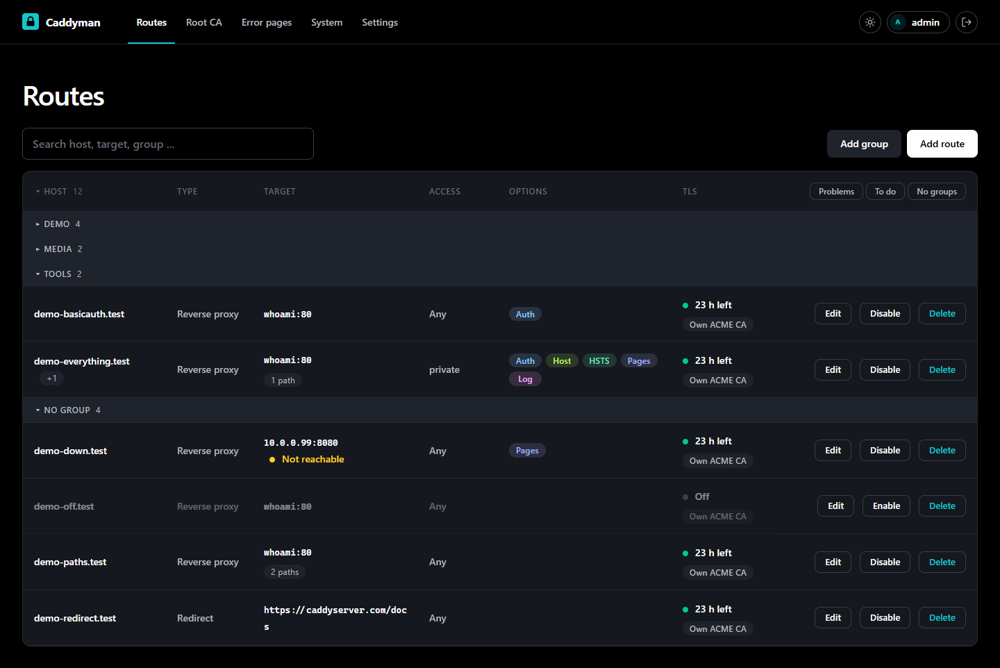

# Caddyman

[](https://github.com/Marschux/Caddyman/tags)
[](LICENSE)
[](https://github.com/Marschux/Caddyman/pkgs/container/caddyman)

A web interface for Caddy routes that works with your own ACME CA, such as
[step-ca](https://smallstep.com/docs/step-ca/).



- **Routes:** reverse proxy, redirect or static files, with several hostnames, wildcard names and paths to other targets; can be switched off without deleting
- **Access per route:** basic auth, allowed networks, or your single sign-on (Authelia, Authentik) through a `forward_auth` snippet; targets with a self-signed certificate work too; HSTS per route
- **Error pages:** when Caddy cannot answer, the visitor gets a page in a design you pick per error instead of
  an empty one; a catch-all route shows a "Blocked" page for names a DNS blocker like Technitium points at Caddy
- **TLS per route:** your own ACME CA, Caddy's default, Let's Encrypt over the DNS challenge, Caddy's internal CA, or none
- **Certificate check:** shows who issued what each route really serves, and when it expires
- **Root CA page:** download, fingerprints, a check code to pass on by voice, and import steps
  for Windows, macOS, Debian, iPhone, Android, Chrome and Firefox; open without a login at `/trust`
- **Logs:** Caddy's log, live and filterable, to see why a certificate did not arrive; rotated
  files too, and an access log per route for the routes that ask for one
- **Backup:** all routes as a ZIP, with a preview before an import writes anything

Caddyman writes one file per route into the directory Caddy already reads, then reloads Caddy.
There is no database that could drift from those files, your base Caddyfile is never written,
and a change Caddy rejects is undone on the spot.

## Installation

**1. Prepare the base Caddyfile.** The status page checks each of these and shows what is missing.

```
{
	log caddyman {
		output file /var/log/caddy/caddy.log
		format json
		exclude http.log.access
	}
}

(stepca) {
	tls {
		ca https://ca.home.example/acme/acme/directory
		ca_root /etc/caddy/root_ca.crt
	}
}

:2020 {
	basic_auth {
		caddyman <hash>
	}
	reverse_proxy localhost:2019 {
		header_up Host {upstream_hostport}
	}
}

import /etc/caddy/sites/*.caddy
```

| Block | Needed for |
|---|---|
| `:2020` site | Caddyman reaching Caddy's admin API, behind a login. Required. Create the hash with `docker exec -it caddy caddy hash-password` |
| `import` | The routes. Required |
| `(stepca)` snippet | The TLS mode "Own ACME CA". Optional; the name is up to you |
| a DNS snippet | The TLS mode "Let's Encrypt over DNS", see below. Optional |
| an SSO snippet | Putting a route behind your single sign-on with one tick: a snippet holding the `forward_auth` of Authelia, Authentik or the like. Optional |
| `log caddyman` | The Logs page. Optional; `docker logs` keeps working next to it |

Do not publish port 2020. Restart Caddy after editing the file.

**2. Start Caddyman** with [`docker/compose.yml`](docker/compose.yml). It mounts Caddy's
Caddyfile, sites directory and log directory at the paths the Caddy container uses and joins the
Docker network `proxy-net`. Adjust the host paths and the network to your setup.

**3. Create the account.** Open `http://<host>:5052/setup` and enter the token from
`docker logs caddyman`. No way to read the log? Set `CADDYMAN_SETUP_TOKEN` to a token of your
own before the first start.

**4. Tell Caddyman where Caddy runs.** The defaults fit the compose file; add the username and
password of the `:2020` site.

**5. Put Caddyman itself behind HTTPS.** Until then your login crosses the network in the clear.
The status page offers the route with one click. Caddyman believes the Caddy it manages when
that says a request came in over HTTPS, so nothing has to be set for it. Only another proxy in
front needs `CADDYMAN_FORWARDED_ALLOW_IPS`; the status page says so if that is the case.

To have even the setup page behind HTTPS, put the route into the sites directory by hand, restart
Caddy, and open Caddyman under that name for step 3. It shows up in the route list later and can be adopted
there:

```
caddyman.home.example {
	import stepca
	reverse_proxy caddyman:5052
}
```

**Let's Encrypt over DNS.** A name that is not reachable from the internet can still get a public
certificate when Caddy proves the name through your DNS provider. That needs a
Caddy built with the provider's plugin, for instance:

```dockerfile
FROM caddy:2-builder AS builder
RUN xcaddy build --with github.com/caddy-dns/cloudflare

FROM caddy:2-alpine
COPY --from=builder /usr/bin/caddy /usr/bin/caddy
```

The Caddy settings show this Dockerfile, the variables and the snippet for a dozen providers, ready to
copy. Give that Caddy the token in its environment, add a snippet to the base Caddyfile above the `import`
line, and name it in the Caddy settings as "DNS snippet". The token never reaches Caddyman; the status
page asks Caddy whether it can read the snippet.

```
(dns) {
	tls {
		dns cloudflare {env.CLOUDFLARE_API_TOKEN}
	}
}
```

Settings are optional and go into a `.env`, see [`docker/.env.example`](docker/.env.example).


## Securing the admin API

Caddy's admin API has no login. Whoever reaches it controls Caddy. That is why the installation
above leaves it on `localhost` and puts a site with a login in front of it. The `header_up` line
in that site is required: the admin API refuses requests that do not carry its own address.

The shortcut is `admin :2019` in the global options block, with `http://caddy:2019` and no login
in Caddyman. It works, but every container on the same Docker network can then reconfigure
Caddy, including every service behind the proxy. The status page marks it.

## Users

The account from the setup page may do everything. Under "Settings", "Users" it adds further
accounts and ticks what each of them may do: change routes and reload Caddy, the Root CA page,
backup and restore, logs, the settings, managing users. An account without any right still sees
the route list and the status page. The change log on the status page names who did what.

Every account can switch on two-factor login in its profile: scan the QR code with an
authenticator app, keep the recovery codes. Whoever manages users can switch it off again for
somebody who lost both. "Settings", "General" makes it a must for every account.

The same block has two switches for the root certificate. "Offer the root CA without a login"
opens `/trust` and the download to everybody who can reach Caddyman; the people who need the
certificate are the ones without an account. "Point to the root CA on the login page" shows a
card below the login form that leads there. Both are on by default.

"Forgot password?" on the login page mails a link that works once and for one hour. It appears
once a mail server is entered under "Settings", "Mail", and reaches accounts that have an
email address. Without mail, whoever manages users sets a new password under "Edit". With
mail, a new account can be created without a password: it gets a link to set its own, good
for one day. Accounts are only ever created by somebody who manages users. A mail
server whose certificate comes from your own CA needs that CA's root certificate in the field
"CA certificate" there.

## Network only: a Caddy on another machine

Choose "Network only" in the setup dialog instead of "Shared files". That is the layout for
every Caddy whose files cannot be mounted into the Caddyman container. Caddyman then keeps the base Caddyfile and the
routes itself and sends both to Caddy as one Caddyfile.

- **Every push replaces Caddy's whole configuration.** The base Caddyfile you paste into Caddyman
  has to contain everything that is not a route, including the site below. Without it, the first
  push locks Caddyman out.
- **Start that Caddy with `--resume`:**
  `caddy run --resume --config /etc/caddy/Caddyfile --adapter caddyfile`.
  Otherwise a restart drops every route. The status page notices when that has happened.
- **Give the login site a real hostname**, so it gets a certificate and the password does not
  cross the network in the clear:

```
admin.home.example {
	basic_auth {
		caddyman <hash>
	}
	handle_path /caddyman-logs/* {
		root * /var/log/caddy
		file_server browse
	}
	handle {
		reverse_proxy localhost:2019 {
			header_up Host {upstream_hostport}
		}
	}
}
```

The `handle_path` block serves the log to the Logs page and can be left out.

The certificate of that site usually comes from your own CA, which the Caddyman container does
not know. Saving the Caddy settings fetches that CA and remembers it for this address; the
status page shows its check code, the same one the Root CA page gives.

## Configuration

| Variable | Default | |
|---|---|---|
| `CADDYMAN_SECRET_KEY` | generated | Signs sessions and links from mails, encrypts the passwords for the admin API and the mail server and the keys of two-factor logins. `openssl rand -base64 32` |
| `CADDYMAN_SETUP_TOKEN` | random, in the log | Your own token for the setup page, at least 12 characters |
| `CADDYMAN_FORWARDED_ALLOW_IPS` | `127.0.0.1` | Whose `X-Forwarded-*` headers are trusted besides the managed Caddy, which is trusted by itself |
| `CADDYMAN_LOG_DIR` | `/var/log/caddy` | Where Caddy's log directory is mounted |
| `TZ` | `UTC` | The time zone the Logs and Changes pages show their times in, like `Europe/Berlin`; one picked under Settings, General comes before it |
| `CADDYMAN_RESET_HTTPS_ONLY` | `false` | Set to `true` for one start to switch "Only answer over HTTPS" off again, when the route to Caddyman is lost |
| `CADDYMAN_DATA_DIR` | `/data` | Account, settings, change log |
| `CADDYMAN_HOST` / `CADDYMAN_PORT` | `0.0.0.0` / `5052` | |
| `CADDYMAN_SOURCE_URL` | this repository | Where the version number in the footer links to. Point it at your own source if you run a modified copy |

## Good to know

- **Set the secret key.** Otherwise one is generated into the data volume, next to what it
  protects.
- **Keep port 5052 published**, even once Caddyman has a route of its own. It is the way back in
  if that route breaks.
- **Locked out for good?** Delete `auth.json` from the data volume and restart. The setup page
  returns with a new token in the log. That removes every account, not just yours.
- **Changed `CADDYMAN_SECRET_KEY`?** Everybody is logged out, and links from mails stop working.
  Enter the passwords for the admin API and the mail server again. Two-factor logins only take
  a recovery code now; whoever manages users can switch the second factor off for an account,
  which then sets it up again.
- **Back up your CA separately.** The backup holds the routes, not the root CA. A lost root has
  to be imported on every device again.
- **The backup has no accounts and no passwords.** It holds the routes and their groups, the
  connection to Caddy, the switches under "General", the designs of the error pages and the mail
  settings without the password. The last four only come back when restoring into an empty install. To keep the
  accounts too, back up the data volume.
- **Restart both containers after editing the base Caddyfile by hand.** Mounted as a single
  file, it can stay stale inside the container when an editor replaces it.
- **One Caddyman manages one Caddy.** For a second Caddy, run a second Caddyman.

Left out on purpose: user management, load balancing, free-form headers, metrics and an undo
history. For history, put the sites directory under Git.

## Development

```
pip install -r docker/requirements.txt
CADDYMAN_DATA_DIR=./data python -m app.server
python -m unittest tests.test_main
```

To build the image: `docker build -f docker/Dockerfile -t ghcr.io/marschux/caddyman:latest .`

## License

AGPL-3.0-or-later. See `LICENSE`. The footer of every page names the license and links to the source;
if you run a modified copy, set `CADDYMAN_SOURCE_URL` to where yours can be found.

## AI use

Most of this project's code was written with AI assistance (Claude Code). Commits and design
decisions were reviewed by the maintainer.

## Links

- [Issues](https://github.com/Marschux/Caddyman/issues)
- [Container registry](https://github.com/Marschux/Caddyman/pkgs/container/caddyman)
