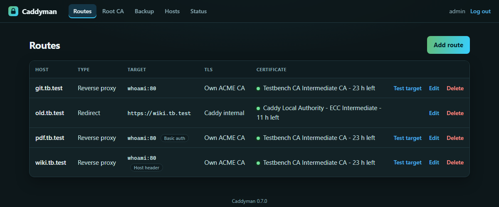
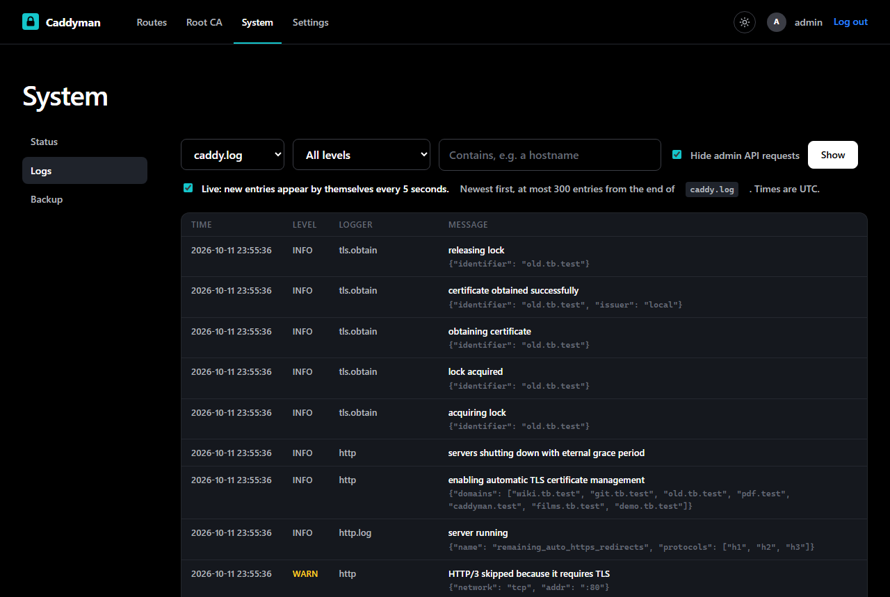

# Caddyman

[](https://github.com/Marschux/Caddyman/tags)
[](LICENSE)
[](https://github.com/Marschux/Caddyman/pkgs/container/caddyman)

A web interface for Caddy routes that works with your own ACME CA, such as
[step-ca](https://smallstep.com/docs/step-ca/).



- **Routes:** reverse proxy, redirect or static files, with optional basic auth
- **TLS per route:** your own ACME CA, Caddy's default, Caddy's internal CA, or none
- **Certificate check:** shows who issued what each route really serves, and when it expires
- **Root CA page:** download, fingerprints and import steps for Windows, Debian and Firefox
- **Logs:** Caddy's log, live and filterable, to see why a certificate did not arrive
- **Backup:** all routes as a ZIP, with a preview before a restore writes anything

Caddyman writes one file per route into the directory Caddy already reads, then reloads Caddy.
There is no database that could drift from those files, your base Caddyfile is never written,
and a change Caddy rejects is undone on the spot.

## Installation

**1. Prepare the base Caddyfile.** The status page checks each of these and shows what is missing.

```
{
	log caddyman {
		output file /var/log/caddy/caddy.log
		format json
	}
}

(stepca) {
	tls {
		ca https://ca.home.example/acme/acme/directory
		ca_root /etc/caddy/root_ca.crt
	}
}

:2020 {
	basic_auth {
		caddyman <hash>
	}
	reverse_proxy localhost:2019 {
		header_up Host {upstream_hostport}
	}
}

import /etc/caddy/sites/*.caddy
```

| Block | Needed for |
|---|---|
| `:2020` site | Caddyman reaching Caddy's admin API, behind a login. Required. Create the hash with `docker exec -it caddy caddy hash-password` |
| `import` | The routes. Required |
| `(stepca)` snippet | The TLS mode "Own ACME CA". Optional; the name is up to you |
| `log caddyman` | The Logs page. Optional; `docker logs` keeps working next to it |

Do not publish port 2020. Restart Caddy after editing the file.

**2. Start Caddyman** with [`docker/compose.yml`](docker/compose.yml). It mounts Caddy's
Caddyfile, sites directory and log directory at the paths the Caddy container uses and joins the
Docker network `proxy-net`. Adjust the host paths and the network to your setup.

**3. Create the account.** Open `http://<host>:5052/setup` and enter the token from
`docker logs caddyman`. No way to read the log? Set `CADDYMAN_SETUP_TOKEN` to a token of your
own before the first start.

**4. Tell Caddyman where Caddy runs.** The defaults fit the compose file; add the username and
password of the `:2020` site.

**5. Put Caddyman itself behind HTTPS.** Until then your login crosses the network in the clear.
The status page offers the route with one click. Set `CADDYMAN_FORWARDED_ALLOW_IPS` to Caddy's
address or the Docker subnet afterwards, so Caddyman knows it is reached over HTTPS.

To have even the setup page behind HTTPS, put the route into the sites directory by hand, restart
Caddy, and open Caddyman under that name for step 3. It shows up in the route list later and can be adopted
there:

```
caddyman.home.example {
	import stepca
	reverse_proxy caddyman:5052
}
```

Settings are optional and go into a `.env`, see [`docker/.env.example`](docker/.env.example).



## Securing the admin API

Caddy's admin API has no login. Whoever reaches it controls Caddy. That is why the installation
above leaves it on `localhost` and puts a site with a login in front of it. The `header_up` line
in that site is required: the admin API refuses requests that do not carry its own address.

The shortcut is `admin :2019` in the global options block, with `http://caddy:2019` and no login
in Caddyman. It works, but every container on the same Docker network can then reconfigure
Caddy, including every service behind the proxy. The status page marks it.

## Caddy on another machine

Choose "Caddyman only reaches Caddy over the network" in the setup dialog. That is the layout for
every Caddy whose files cannot be mounted into the Caddyman container. Caddyman then keeps the base Caddyfile and the
routes itself and sends both to Caddy as one Caddyfile.

- **Every push replaces Caddy's whole configuration.** The base Caddyfile you paste into Caddyman
  has to contain everything that is not a route, including the site below. Without it, the first
  push locks Caddyman out.
- **Start that Caddy with `--resume`:**
  `caddy run --resume --config /etc/caddy/Caddyfile --adapter caddyfile`.
  Otherwise a restart drops every route. The status page notices when that has happened.
- **Give the login site a real hostname**, so it gets a certificate and the password does not
  cross the network in the clear:

```
admin.home.example {
	basic_auth {
		caddyman <hash>
	}
	handle_path /caddyman-logs/* {
		root * /var/log/caddy
		file_server
	}
	handle {
		reverse_proxy localhost:2019 {
			header_up Host {upstream_hostport}
		}
	}
}
```

The `handle_path` block serves the log to the Logs page and can be left out.

## Configuration

| Variable | Default | |
|---|---|---|
| `CADDYMAN_SECRET_KEY` | generated | Signs sessions and encrypts the admin API password. `openssl rand -base64 32` |
| `CADDYMAN_SETUP_TOKEN` | random, in the log | Your own token for the setup page, at least 12 characters |
| `CADDYMAN_FORWARDED_ALLOW_IPS` | `127.0.0.1` | Whose `X-Forwarded-*` headers are trusted. Behind Caddy: its address or the Docker subnet |
| `CADDYMAN_LOG_DIR` | `/var/log/caddy` | Where Caddy's log directory is mounted |
| `CADDYMAN_DATA_DIR` | `/data` | Account, settings, change log |
| `CADDYMAN_HOST` / `CADDYMAN_PORT` | `0.0.0.0` / `5052` | |
| `CADDYMAN_SOURCE_URL` | this repository | The "Source" link in the footer. Point it at your own source if you run a modified copy |

## Good to know

- **Set the secret key.** Otherwise one is generated into the data volume, next to what it
  protects.
- **Keep port 5052 published**, even once Caddyman has a route of its own. It is the way back in
  if that route breaks.
- **Forgot the password?** Delete `auth.json` from the data volume and restart. The setup page
  returns with a new token in the log.
- **Back up your CA separately.** The backup holds the routes, not the root CA. A lost root has
  to be imported on every device again.
- **Restart both containers after editing the base Caddyfile by hand.** Mounted as a single
  file, it can stay stale inside the container when an editor replaces it.
- **One Caddyman manages one Caddy.** For a second Caddy, run a second Caddyman.

Left out on purpose: user management, load balancing, free-form headers, metrics and an undo
history. For history, put the sites directory under Git.

## Development

```
pip install -r docker/requirements.txt
CADDYMAN_DATA_DIR=./data python -m app.server
python -m unittest tests.test_main
```

To build the image: `docker build -f docker/Dockerfile -t ghcr.io/marschux/caddyman:latest .`

## License

AGPL-3.0-or-later. See `LICENSE`. The footer of every page names the license and links to the source;
if you run a modified copy, set `CADDYMAN_SOURCE_URL` to where yours can be found.

## AI use

Most of this project's code was written with AI assistance (Claude Code). Commits and design
decisions were reviewed by the maintainer.

## Links

- [Issues](https://github.com/Marschux/Caddyman/issues)
- [Container registry](https://github.com/Marschux/Caddyman/pkgs/container/caddyman)
